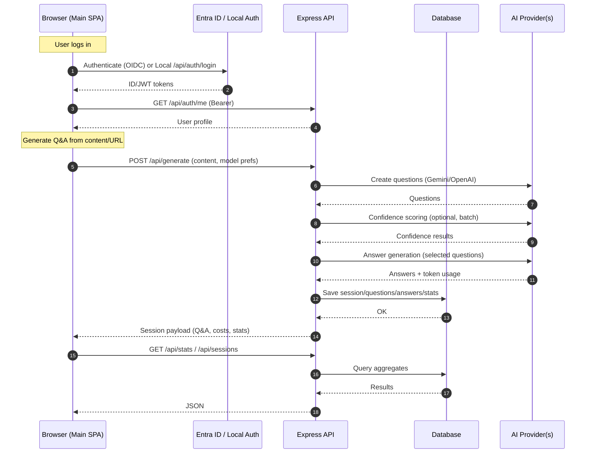

## Genfuze.ai Reference Architecture

This document describes the recommended architecture for the Genfuze.ai platform: a multi-app system for AI-powered Q&A generation, with a marketing/landing site and a main application backed by a Node/Express API.

### Scope
- Applies to `content-genesis-optimizer-main` (landing SPA), `auto_browser/project` (main SPA), and `auto_browser/project/backend` (API).
- Covers local dev and production deployments; highlights optional enterprise auth via Microsoft Entra ID in addition to local JWT auth.

### Components
- Frontend SPAs
  - `content-genesis-optimizer-main`: marketing/landing (port 5173 in dev)
  - `auto_browser/project`: main app (port 5174 in dev)
- Backend API: `auto_browser/project/backend` (port 5000 in dev)
- Data stores
  - Dev: SQLite (current)
  - Prod: PostgreSQL (recommended)
  - Optional: Object storage for exports/attachments (e.g., S3/Azure Blob)
- Caching/Queues (recommended): Redis for rate-limiting, job queues
- Third-party integrations: Gemini, OpenAI, Perplexity, Google Serper
- Authentication
  - Local JWT (default)
  - Microsoft Entra ID / OIDC (enterprise option)
- Observability: logging, metrics, tracing (recommended stack: OpenTelemetry + vendor backend)

### High-level architecture
```mermaid
graph TD
    U[User Browser] -->|HTTPS| CDN[CDN + WAF]
    CDN --> LP[Landing SPA (content-genesis-optimizer-main)]
    CDN --> APP[Main SPA (auto_browser/project)]
    APP -->|/api| LB[API Gateway / Load Balancer]
    LB --> API[Express API (Node)]

    subgraph Core Services
      API --> DB[(Primary DB: PostgreSQL)]
      API --> RDS[(Redis: cache, rate limit, queues)]
      API --> OBJ[(Object Storage: exports)]
      API --> LOG[Logs/Metrics/Traces]
    end

    subgraph AI Providers
      API --> GEM[Gemini]
      API --> OAI[OpenAI]
      API --> PPX[Perplexity]
      API --> SRP[Google Serper]
    end

    subgraph Auth
      APP --> OIDC[OIDC Provider (Microsoft Entra ID)]
      OIDC --> API
    end

    classDef infra fill:#0b1220,stroke:#00ff88,color:#e2e8f0
    classDef svc fill:#0f172a,stroke:#22c55e,color:#e2e8f0
    class CDN,LB,OBJ,RDS,DB,LOG infra
    class API,APP,LP svc
```

### Request and data flow


### API boundaries (illustrative)
- Auth: `/api/auth/login`, `/api/auth/refresh`, `/api/auth/logout`, `/api/auth/me`
- Sessions: `/api/sessions`, `/api/sessions/:type`, `/api/sessions/:type/:id`, DELETE `/api/sessions/:id`
- Stats: `/api/stats/:type`
- Migration/Export: `/api/migrate`, `/api/export/:type/csv`

### Data model (core entities)
- User: id, email, name, tenant_id, roles, last_login_at
- UserSession: refresh_token, expires_at
- Session: id, user_id, name, type (question|answer), timestamp, model, blog_content/blog_url, token usage
- QA Items (logical): question, answer, confidence, costs

### Environments
- Development (current)
  - `5173` landing SPA, `5174` main SPA, `5000` API
  - SQLite DB, local JWT or mock OIDC
- Production (recommended)
  - Managed PostgreSQL, Redis, Object Storage
  - CDN + WAF in front of SPAs and API
  - OIDC with Microsoft Entra ID for enterprise SSO (optional)

### Production topology (recommended)
- Networking
  - Private subnets for API, DB, Redis; public only for CDN/Edge
  - API behind L7 load balancer with TLS termination; mTLS optional internal
- Compute
  - Containerize API; orchestrate with Kubernetes or ECS/AKS/GKE
  - SPAs served from CDN-backed object storage (immutable builds)
- Data
  - PostgreSQL primary + read replica(s); automated backups and PITR
  - Redis for caching, rate limiting, and durable queues (e.g., bullmq)
  - Object storage for exported CSVs and large payloads
- Observability
  - Structured JSON logs, request IDs, distributed tracing (OpenTelemetry)
  - Metrics: latency, error rate, token usage, queue depth, cache hit rate
- Security
  - OIDC for SSO; least-privilege service principals
  - Secret management (cloud KMS/Secrets Manager/Azure Key Vault)
  - CORS allowlist; WAF rules; rate limiting & IP throttling
  - Input validation and SSRF protection for URL-based content fetches
  - Token/key partitioning for question vs answer providers

### Scaling & performance
- Frontends: static assets via CDN; cache-bust via content hashing
- API: horizontal scaling; stateless services; use Redis for shared state
- AI calls
  - Separate providers/keys for questions vs answers to optimize cost/quotas
  - Backoff and circuit breakers; retries on safe endpoints
  - Batch confidence scoring to reduce round-trips
- Data
  - Use read replicas for analytics/exports
  - Add pagination and time-bounded queries for history/stats endpoints
  - Async jobs for heavy tasks (scraping, large sessions, email)

### Cost optimization
- Model selection per task: cheaper models for question generation; premium for answers
- Batch operations and token-conservative prompts
- Cache upstream search results (Serper) temporarily
- Export and analytics offloaded to async workers when large

### Security recommendations
- JWT hardening: short-lived access tokens, refresh flow, audience/issuer checks
- OIDC: PKCE, strict redirect URIs, incremental consent
- API hardening: rate limits, input validation, output encoding, avoid error leakage
- Data: encrypt at rest/in transit; rotate keys; role-based access enforcement
- Supply chain: pin dependencies; SCA scanning; container image scanning

### Configuration & secrets
- Frontend `.env`
  - `VITE_REACT_APP_API_URL` (API base URL)
  - `VITE_APP_NAME`
- Backend `.env`
  - Ports, JWT secrets, provider API keys, DB/Redis/Object storage URLs
  - OIDC: `AZURE_CLIENT_ID`, `AZURE_TENANT_ID`, redirect URIs
- Store secrets in managed secret stores; never commit `.env`

### Local development
- Start landing SPA (5173), main SPA (5174), backend API (5000)
- Use SQLite for convenience; can run Postgres and Redis locally via Docker
- Feature flags to toggle AI confidence method, provider selection, and quotas

### Deployment checklist
- CI/CD builds SPAs (artifact upload to CDN) and API images
- Run DB migrations on deploy (idempotent)
- Seed minimal configuration; rotate secrets
- Health probes, readiness gates, auto-scaling rules
- Observability wired and dashboards/alerts in place

### Roadmap options
- Move session storage from JSON/SQLite to PostgreSQL in all environments
- Introduce background workers for heavy tasks and email
- Add per-tenant quotas and billing hooks
- Add canary deploys and error budgets for AI provider calls

---
This reference architecture aligns with the current codebase while providing a clear path to a production-ready, scalable, and secure deployment.

